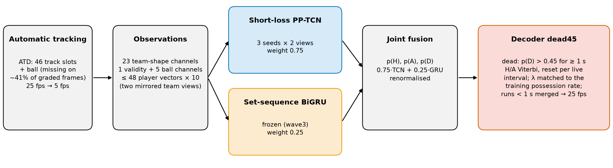
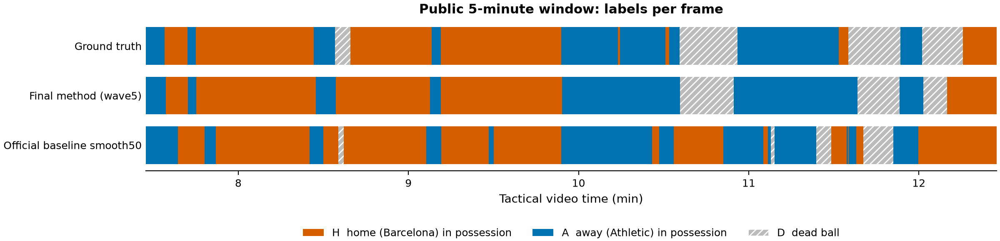
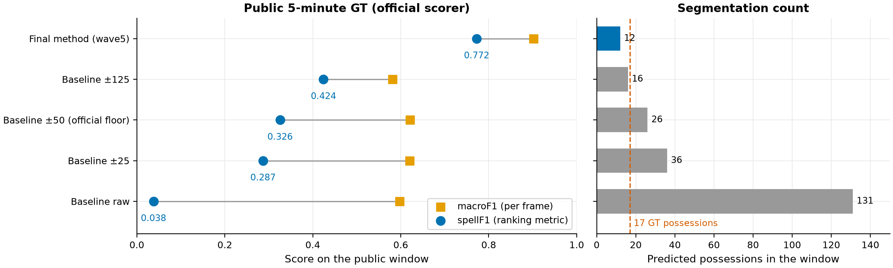
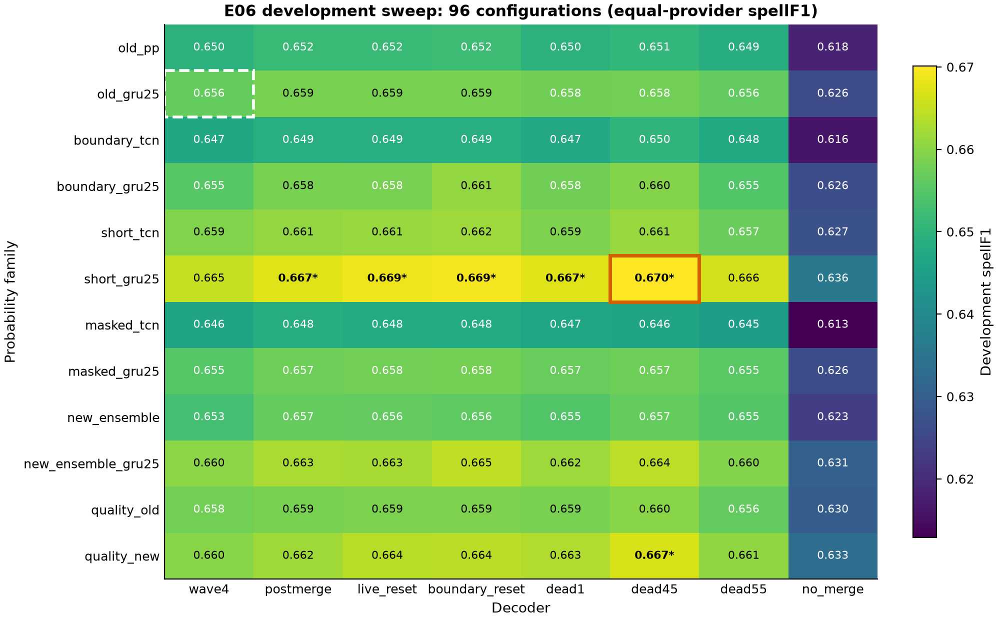
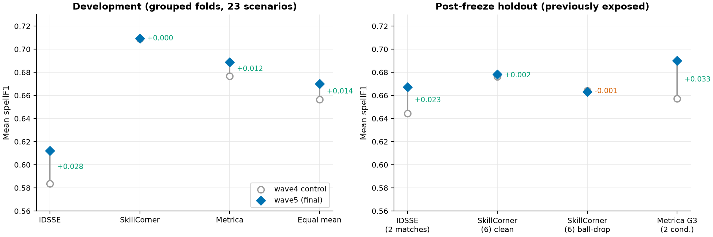
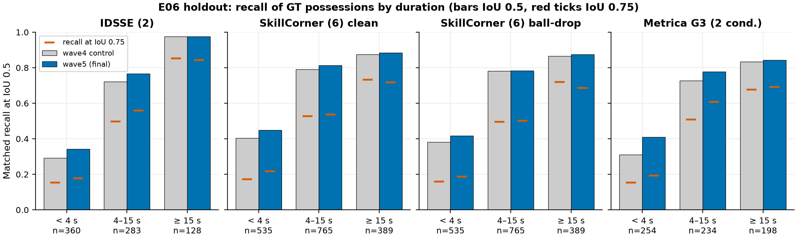
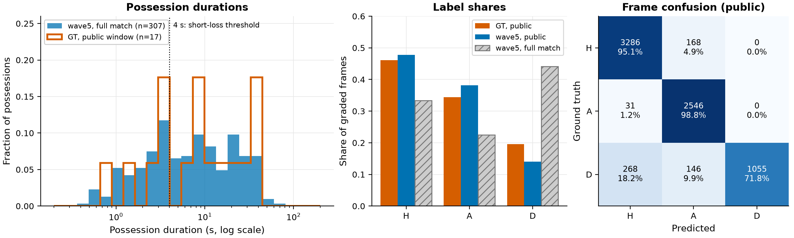
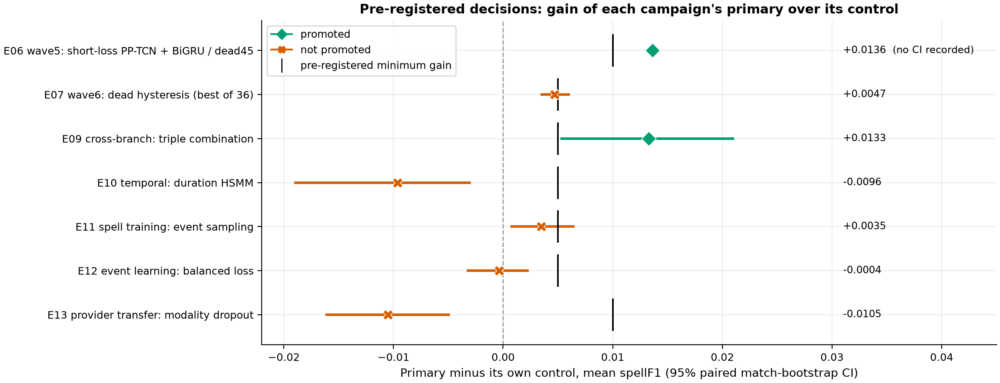
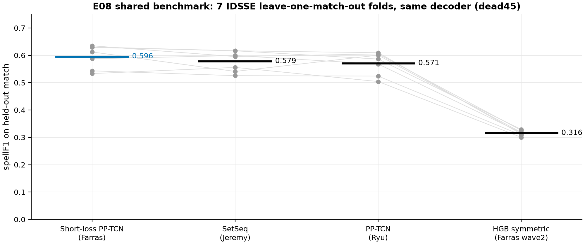

# Possession as Segmentation: Frame-level Ball Possession from Noisy Tracking

**More than a Hack 2027 — Phase 1 · Submission of Admin Team, Institut Teknologi Sepuluh Nopember (Indonesia)**

Rasya Arya Ramadhan · Benedictus Ryu Gunawan · Ahmad Naufal Farras · Jeremy Mattathis Mboe · Jylan Annisa Mumtaza Syidana

Challenge organised by [Metrica Sports](https://metrica-sports.com), the [FC Barcelona Innovation Hub](https://www.fcbarcelona.com) and the [Mobile World Capital Barcelona](https://www.mwcbarcelona.com).

| Deliverable | File |
|---|---|
| Possession file (scored) | [`submission.csv`](submission.csv) — 199,319 rows, SHA-256 `cd59fb902882f34d53983cf78478b93a3757bafde65d83e5502f157be214fdb8` |
| Technical document | [`TECHNICAL_REPORT.pdf`](TECHNICAL_REPORT.pdf) (IEEE format, source [`docs/report/`](docs/report/)) |
| Code | this repository — final method in [`experiments/E06_wave5/`](experiments/E06_wave5/) |

---

## Abstract

Every one of the 199,319 frames of a full LaLiga match (FC Barcelona vs Athletic Club) must be labelled home possession (`H`), away possession (`A`), dead ball (`D`) or no answer (`X`), using only automatic, uncorrected tracking in which the ball is missing on about 41% of graded frames. Because the ranking metric (spellF1) scores whole possessions rather than frames, we treat the task as **temporal segmentation**. The final method combines a three-seed temporal convolutional network with an attention-pooled player-set branch (PP-TCN), trained on 19 external matches with the state loss doubled on complete possessions shorter than 4 s, with a frozen set-sequence BiGRU (75/25 joint mixture). A decoder then masks dead balls, runs an interval-reset two-state Viterbi pass whose switch cost is calibrated to the training possession rate, and merges sub-second runs. The configuration was selected by a pre-registered, provider-balanced rule over 96 configurations: external development spellF1 **0.670** (+0.014 over the previous campaign). On the 5-minute public ground truth it scores spellF1 **0.772** and macroF1 **0.902**, against 0.326 / 0.621 for the official baseline. The full-match score is unknown. Fourteen experiments, including six negative or non-promoted ones, are documented with their decision rules and evidence.

## Contents

1. [Problem and metric](#1-problem-and-metric)
2. [Data analysis: what makes it hard](#2-data-analysis-what-makes-it-hard)
3. [Method](#3-method)
4. [Training data and protocol](#4-training-data-and-protocol)
5. [Results](#5-results)
6. [Research history](#6-research-history)
7. [Limitations and threats to validity](#7-limitations-and-threats-to-validity)
8. [Reproducibility](#8-reproducibility)
9. [Repository layout](#9-repository-layout)
10. [Challenge documents, licence and citation](#10-challenge-documents-licence-and-citation)

---

## 1. Problem and metric

| | |
|---|---|
| **Input** | tactical video (reference timeline), broadcast video (not synchronised), automatic tracking (ATD) with the ball, Smart Tagging, homography |
| **Output** | `frame,label` CSV, 199,319 rows, labels `H` / `A` / `D` / `X` |
| **Graded frames** | 158,857 (two halves); everything else is free `X` |
| **Public GT** | 7,500 frames, 17 possessions — for checking the pipeline, never for tuning ([RULES.md](RULES.md)) |
| **Private GT** | the full match, used for the official ranking |

A *possession* (spell) is a maximal run of one team with the ball alive. Predicted and true spells of the same team are matched one-to-one; the F1 of that matching is averaged over five IoU thresholds:

$$
\mathrm{IoU}(p,g)=\frac{|p\cap g|}{|p\cup g|},\qquad
\mathrm{spellF1}=\frac{1}{5}\sum_{\tau\in\{0.3,0.4,0.5,0.6,0.7\}}\mathrm{F1}_\tau .
$$

Every spell counts once, so a one-frame flicker inside a long possession costs a whole spell, and a missed 2-second possession costs as much as a missed 40-second one. **macroF1** (mean per-frame F1 over H/A/D) is reported as the secondary metric. The two disagree strongly: the four official baselines differ only in a smoothing window, and spellF1 moves eleven times as much as macroF1 ([EVALUATION.md](EVALUATION.md); [§5.1](#51-public-window-diagnostic)).

## 2. Data analysis: what makes it hard

From [E00](experiments/E00_eda/) (computed on ATD and Smart Tagging only, without the GT):

| Property | Value | Design consequence |
|---|---|---|
| Ball visible on graded frames | 59.3% | the ball is missing on 40.7% of frames → use player configuration, not only the ball |
| Ball-missing gaps | 150; median 10.7 s, P90 33.8 s, max 221 s | 85.2% of missing frames lie in gaps > 10 s → holding the last label is unsafe; long temporal context needed |
| P(ball lost within 1 s \| visible) | 3.6% | ball loss is a persistent state, not per-frame noise |
| Track slots / tracked players per frame | 46 slots (24 H, 22 A) / mean 20.5 | slots are not players → team-level or permutation-invariant features |
| Tracklet length | median 13.6 s, P90 201 s | per-slot features are unstable |
| Nearest-player distance to ball | median 1.9 m (P90 7.0 m) | proximity is informative when the ball is visible |
| Home/away nearest-distance margin < 2 m | 32.5% of visible frames | "nearest player" is ambiguous a third of the time → temporal evidence needed |
| Smart Tagging `Team` agreement with geometry | 53.7% raw, 63.4% after flipping "defending" codes | tag semantics are a trap; not used as input |
| Broadcast homography valid | 65.8% | broadcast not synchronised; not used |

## 3. Method



*Figure 1. The final pipeline, `farras_wave5_short_gru25_dead45`. The model works offline at 5 fps; labels are expanded to the 25-fps tactical timeline.*

**Observations.** For each of two mirrored team views: 23 team-shape channels (depth, length, width, compactness, speeds, own-goal-area counts …), a validity flag, 5 ball channels (control, visibility, log speed, distance inside the pitch, log nearest distance) and an unordered set of up to 48 player vectors (10 features: same team, attacking x/y and velocity, speed, ball distance, ball visible, closing speed, nearest-opponent distance).

**Short-loss PP-TCN (weight 0.75).** A 1×1 input projection to 64 channels, then six residual blocks (GroupNorm → dilated Conv1d, kernel 5, dilations 1/2/4/8/16/1 → GELU → dropout 0.15). Receptive field: 129 samples (±12.8 s). The player set is encoded by a two-layer MLP and pooled by softmax attention plus a masked max (permutation-invariant), then added to the temporal stream. Two logits per sample: dead ball, and "my team has the ball". Both are trained with binary cross-entropy, and the **team-state loss is multiplied by 2 on complete live spells shorter than 4 s** (duration measured on the full half, so crop fragments are not up-weighted). Recipe: AdamW (lr 0.002, weight decay 0.01), OneCycle, 1,500 updates of batch 16 on 384-sample crops, ball masking p = 0.3, seeds 0/1/2 averaged over both views. 135,219 parameters per network.

**Frozen BiGRU (weight 0.25).** Player-set encoder followed by a two-layer bidirectional GRU (hidden 32, window 300), trained in [E04](experiments/E04_wave3/) on 5 IDSSE matches and kept frozen.

**Fusion.** $p = 0.75\,p_\text{TCN} + 0.25\,p_\text{GRU}$ on the joint $(p_H, p_A, p_D)$, then renormalised.

**Decoder `dead45`.**
1. *Dead mask:* a sample is dead if $p_D > 0.45$ within a run lasting ≥ 1 s.
2. *Team evidence:* $\ell_H=\kappa\log p_T$, $\ell_A=\kappa\log(1-p_T)$ with $\kappa=0.05$. When the ball is visible and a player is within 0.35 m, add $-\log(1+e^{-m})$ to $\ell_H$ and $-\log(1+e^{m})$ to $\ell_A$, where $m=(d_A-d_H)/\tau$ and $\tau=3$.
3. *Viterbi:* a two-state H/A Viterbi pass with switch cost λ, **reset in every live interval** so that no possession crosses a stoppage.
4. *Rate calibration:* λ is chosen from an 18-value grid so the decoded possession count (after merging) matches $\hat n=\rho\cdot T_\text{graded}$. Here $\rho$ is the possession rate per minute estimated from the training matches only, provider-balanced. No target labels are used.
5. *Merge:* live runs shorter than 1 s are absorbed into the previous run.

There is no target-specific rule (no forced dead balls or kickoff handling). Video, Smart Tagging, homography and any human labels of the target match are **not** inputs. Full specification: [docs/FINAL_METHOD.md](docs/FINAL_METHOD.md).

## 4. Training data and protocol

No labelled data from the provided match is used for training.

| Source | Matches | Labels | Licence | Role in the final method |
|---|---:|---|---|---|
| [IDSSE](https://doi.org/10.1038/s41597-025-04505-y) (Bassek et al. 2025) | 7 (5 train, 2 holdout) | provider possession labels | CC BY 4.0 | PP-TCN and BiGRU training; holdout |
| [SkillCorner open data](https://github.com/SkillCorner/opendata) | 20 (14 train, 6 holdout) | provider phases of play (proxy) | MIT | PP-TCN training; holdout + ball-drop stress |
| [Metrica sample data](https://github.com/metrica-sports/sample-data) | 3 (zero-shot) | event-derived proxy | no explicit licence found | development selection (Games 1/2), evaluation (Game 3); never training |

**Protocol.** There are six grouped folds, and all corruption rounds of a match leave the training set together. Normalisation and decoder statistics come from the training fold only. The objective is the **equal-provider mean spellF1**: conditions are averaged within a match, then matches within a provider, then the three providers with equal weight. It covers 23 development scenarios from 21 matches. The adoption rule was hashed before fitting: a challenger replaces the control only if it gains ≥ 0.01, wins ≥ 2 of 3 providers, and loses ≤ 0.03 on any provider.

## 5. Results

### 5.1 Public window (diagnostic)



*Figure 2. Labels on the 5-minute public window. The baseline fragments long possessions; the final method recovers them with boundaries within a few frames, but merges several brief exchanges between minutes 10 and 12.*



*Figure 3. Official scorer on the public GT. Left: spellF1 (circles) and macroF1 (squares). Right: number of predicted possessions against the 17 in the GT.*

| Submission | spellF1 | macroF1 | Cohen's κ | Possessions | Mean duration (s) | Transition F1 (±25 fr.) |
|---|---:|---:|---:|---:|---:|---:|
| **Final method (wave5)** | **0.772** | **0.902** | **0.868** | 12 | 21.5 | **0.588** |
| Baseline ±125 | 0.424 | 0.581 | 0.536 | 16 | 18.5 | 0.167 |
| Baseline ±50 (official floor) | 0.326 | 0.621 | 0.520 | 26 | 10.8 | 0.082 |
| Baseline ±25 | 0.287 | 0.620 | 0.488 | 36 | 7.6 | 0.203 |
| Baseline raw | 0.038 | 0.597 | 0.428 | 131 | 2.0 | 0.141 |

GT: 17 possessions, mean 14.2 s. These numbers were recomputed with [`evaluation/run_evaluation.py`](evaluation/run_evaluation.py). With 17 possessions, one possession moves spellF1 by about 0.06; this is a pipeline check, not evidence of private performance.

### 5.2 Selection on external data



*Figure 4. All 96 configurations of the selection campaign (12 probability families × 8 decoders). Six pass the pre-registered rule (\*); the best, `short_gru25/dead45`, is selected. Removing the 1-s merge (`no_merge`) is the most damaging decoder change in every family.*



*Figure 5. Final method vs the previous campaign's control. Left: development per provider. Right: holdout cohorts evaluated after the freeze (all matches had been seen in earlier campaigns; the ball-drop cohort removes 35% of visible-ball samples from the same six SkillCorner matches).*

| Development provider | Control (wave4) | Final (wave5) | Δ |
|---|---:|---:|---:|
| IDSSE | 0.584 | 0.612 | +0.028 |
| SkillCorner | 0.709 | 0.709 | +0.000 |
| Metrica | 0.677 | 0.689 | +0.012 |
| **Equal mean** | **0.656** | **0.670** | **+0.014** |

### 5.3 Where the method succeeds and fails



*Figure 6. Recall of GT possessions by duration on the holdout cohorts (bars: IoU 0.5; red ticks: IoU 0.75). The short-possession loss raises recall of spells < 4 s in every cohort, but short recall stays below 25% at IoU 0.75.*

| Ball-drop stress (pooled, IoU 0.75) | Control | Final |
|---|---:|---:|
| Predicted possessions | 1,613 | 1,713 |
| Matched possessions | 744 | 751 |
| Precision | 46.13% | 43.84% |
| Recall of GT ≥ 15 s | 71.98% | 68.64% |

When more ball observations are removed, the final method creates more spurious possessions and loses some long ones. This is the main open problem.



*Figure 7. Left: possession durations predicted over the full match (307 possessions, median 6.6 s) vs the public GT. Centre: label shares. Right: frame confusion on the public window. Team errors are rare (4.9% of H frames, 1.2% of A frames), while 28.2% of dead-ball frames are labelled live: stoppages are detected late or shortened. The 44.1% dead share predicted over the full match cannot be checked without the private GT.*

## 6. Research history

Fourteen experiments were run in sequence; each campaign's control is the previous campaign's result. Each folder has a record card (`CARD.md`) and a README with test steps. Index: [experiments/REGISTRY.md](experiments/REGISTRY.md).

| ID | Experiment | Question | Primary result | Verdict |
|---|---|---|---|---|
| [E00](experiments/E00_eda/) | EDA | What does the tracking look like? | ball missing on 40.7% of graded frames | shaped the design |
| [E01](experiments/E01_baseline/) | Official baseline | How does nearest player + vote behave? | public 0.326, full match 0.2433 | reference floor |
| [E02](experiments/E02_wave1/) | Wave1 | Rules vs learned models on Metrica | hysteresis, dev 0.461 | superseded |
| [E03](experiments/E03_wave2/) | Wave2 | Gradient boosting + Viterbi | dev 0.517 | superseded |
| [E04](experiments/E04_wave3/) | Wave3 | Set+BiGRU with control features | dev 0.615 | superseded (BiGRU reused) |
| [E05](experiments/E05_wave4/) | Wave4 | PP-TCN across three providers | dev 0.656 | control of E06 |
| [E06](experiments/E06_wave5/) | **Wave5** | **Short-possession loss** | **dev 0.670 (+0.014)** | **final method** |
| [E07](experiments/E07_wave6/) | Wave6 | Fusion/decoder only | dev 0.675 (+0.0047 < 0.005) | not promoted |
| [E08](experiments/E08_fair_idsse/) | Fair benchmark | Families on one split and decoder | short-loss PP-TCN 0.596 | benchmark |
| [E09](experiments/E09_cross_branch/) | Cross-branch | All branches' cues combined | 0.609 (+0.013) | research primary passed |
| [E10](experiments/E10_temporal_methods/) | Temporal decoders | Duration HSMM, consensus | 0.606 (−0.010) | rejected |
| [E11](experiments/E11_spell_training/) | Spell training | Event sampling, spell loss | 0.619 (+0.003 < 0.005) | not promoted |
| [E12](experiments/E12_event_learning/) | Event learning | Six training recipes | 0.619 (−0.0004) | rejected |
| [E13](experiments/E13_provider_generalization/) | Provider transfer | Regularisers for unseen providers | 0.530 (−0.010) | rejected |



*Figure 8. Every campaign's pre-registered primary against its own control, with 95% paired match-bootstrap intervals where recorded and the pre-registered minimum gain (black tick). Only E06 (the final method) and E09 (research-only) passed; E07 missed its threshold by 0.0003 and was not promoted even though it scores higher on the public window (0.786). Cohorts differ between rows, so compare each row only with its own threshold.*



*Figure 9. E08: the team's model families retrained on the same 7 IDSSE leave-one-match-out folds and decoded with the same decoder. Grey dots are individual held-out matches. The short-loss PP-TCN leads on the mean, but its interval against SetSeq still crosses zero.*

## 7. Limitations and threats to validity

- **Adaptive evaluation.** All external holdout matches and the public window had been seen by earlier campaigns. Results are adaptive estimates, not a fresh blind test. Bootstrap intervals are not corrected for multiple comparisons.
- **Proxy labels.** SkillCorner (phases of play) and Metrica (events) differ from the corrected-tracking definition of the target GT.
- **Short possessions and ball loss.** Short-spell recall is below 25% at IoU 0.75. Under heavy ball loss, precision and long-spell recall drop ([§5.3](#53-where-the-method-succeeds-and-fails)).
- **Offline method.** Centred convolutions and the bidirectional GRU use future context. The method is not real-time.
- **Reproduction gap.** The CSV is reproduced byte for byte from the prepared caches and frozen models. A rebuild from the raw data bundle to the identical CSV is not yet complete, so [RULES.md](RULES.md) §3 is not fully met.
- **Leakage audit.** No path from competition GT into training, inference or selection was found ([E13 exposure audit](experiments/E13_provider_generalization/EXPOSURE.md)). This is not a certificate of being leakage-free.
- **Licence.** Metrica sample data has no explicit licence; it is used only for evaluation.

## 8. Reproducibility

**Without match data** (fresh clone):

```bash
pip install -r requirements.txt
python evaluation/validate_submission.py submission.csv    # official format check
python -B submission/export.py --output submission.csv     # re-export; must print SHA256 cd59fb90…
python experiments/check_results.py                        # 67 checks of every experiment's recorded results
cp submission.csv evaluation/results/wave5.csv && python evaluation/run_evaluation.py   # public diagnostic (§5.1)
python -B -m pytest -q experiments/E06_wave5                # unit tests of one experiment (needs its requirements.txt)
python image/make_figures.py                                # regenerate every figure in image/
```

**With the match data:**

1. Enrol, download the bundle and unpack it into `data/` (or set `MTAH_DATA_DIR`) — [DATA.md](DATA.md).
2. Data analysis: [`experiments/E00_eda/E00_eda.ipynb`](experiments/E00_eda/E00_eda.ipynb). Baselines: `python starter/baseline.py` ([E01](experiments/E01_baseline/README.md)).
3. Rebuild and explain the final CSV: [`experiments/E06_wave5/E06_wave5.ipynb`](experiments/E06_wave5/E06_wave5.ipynb). It needs the frozen caches and checkpoint listed in [its README](experiments/E06_wave5/README.md). It checks the rebuilt CSV's hash against the one above, then explains the predictions (stage ablations, Integrated Gradients, temporal receptive field, attention, occlusion, seed uncertainty, error anatomy).
4. Technical report: [docs/report/README.md](docs/report/README.md).

Notebooks need `requirements-starter.txt`; each campaign pins its own `experiments/<EXX>/requirements.txt` (Python 3.10).

## 9. Repository layout

```
submission.csv              final possession file
TECHNICAL_REPORT.pdf        technical document
image/                      README figures and the script that draws them (make_figures.py)
submission/                 export tool for the frozen CSV: export.py, method.json, artifacts/, verification records
docs/
  FINAL_METHOD.md           locked description of the final method (facts as data in final_method.json)
  BRANCHES.md               what each team branch contains; how to read historical numbers
  report/                   Typst source of the technical report, figure script, bibliography
experiments/
  REGISTRY.md               every experiment in run order
  E00_eda/ … E13_*/         one folder per experiment: code, CARD.md, README.md (how to test), results/
  check_results.py          recomputes every experiment's headline numbers from its results/*.json
  CAMPAIGNS.md              inputs and environment shared by the scripted campaigns E02–E13
  common.py, _template/     shared helpers and the template for a new experiment
evaluation/                 official scorer, validator, public 5-minute GT, baseline CSVs
starter/                    organisers' loaders, baseline and tutorial notebooks
games.py                    per-match constants, asset paths and frame alignment
data/                       unpack the match bundle here (gitignored)
```

Match data, caches, model weights and per-frame predictions other than `submission.csv` are not in the repository; the match data is not redistributable.

## 10. Challenge documents, licence and citation

Organisers' documents defining the task and rules: [CHALLENGE.md](CHALLENGE.md) · [DATA.md](DATA.md) · [EVALUATION.md](EVALUATION.md) · [SUBMISSION.md](SUBMISSION.md) · [RULES.md](RULES.md) · [FAQ.md](FAQ.md) · [OVERVIEW.md](OVERVIEW.md).

The challenge code and documentation are released by the organisers under the MIT Licence ([LICENSE](LICENSE)). **The match data is not covered by it**: it is licensed for this competition only. External data: IDSSE (CC BY 4.0), SkillCorner open data (MIT), Metrica sample data (evaluation only).

```bibtex
@misc{mtah2027,
  title  = {More than a Hack 2027: Phase 1 - Ball Possession},
  author = {Metrica Sports and FC Barcelona Innovation Hub},
  year   = {2027},
  url    = {https://github.com/metrica-sports/more-than-a-hack-2027}
}

@article{bassek2025,
  author  = {Bassek, Manuel and Rein, Robert and Weber, Hendrik and Memmert, Daniel},
  title   = {An integrated dataset of spatiotemporal and event data in elite soccer},
  journal = {Scientific Data}, volume = {12}, number = {1}, pages = {195}, year = {2025},
  doi     = {10.1038/s41597-025-04505-y}
}
```

Figures were produced with Matplotlib using colour-blind-safe Okabe–Ito colours, with the help of the Scientific Agent Skills library (Kassis et al., 2026, [arXiv:2609.00065](https://doi.org/10.48550/arXiv.2609.00065)).
